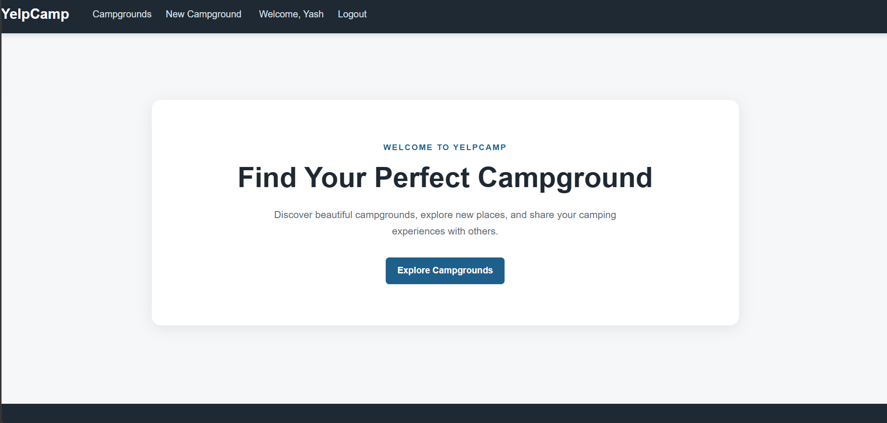
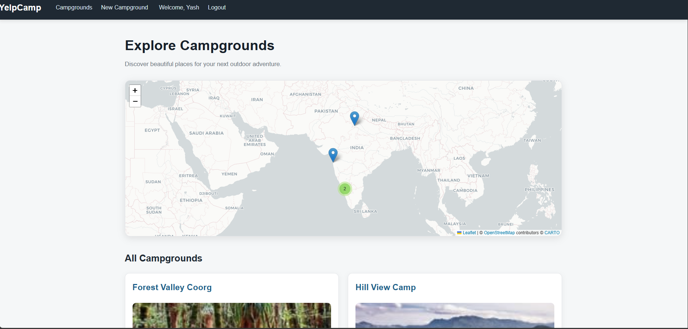
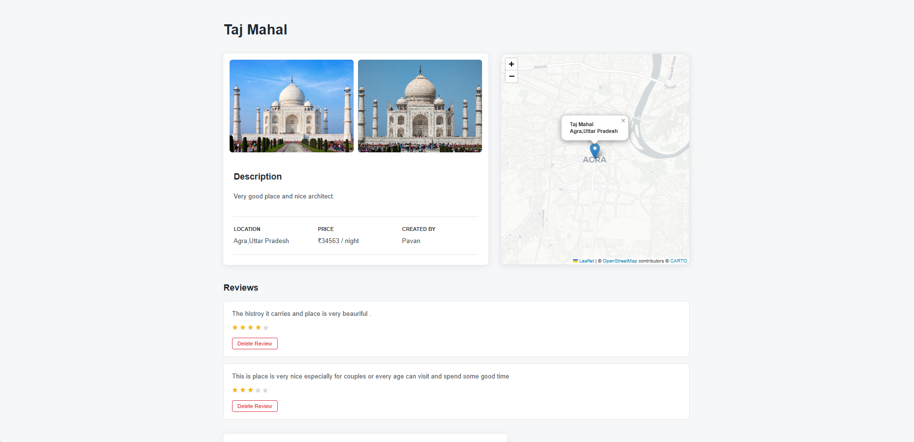

# YelpCamp

YelpCamp is a full-stack campground web application where users can discover campgrounds, create new listings, upload images, and share reviews.

# 🚀 Features

# 👤 User Authentication
- User registration and login
- Authentication and authorization
- Secure logout

# 🏕️ Campground Management
- Create campground listings
- View campground details
- Edit campground information
- Delete campgrounds
- Upload campground images

# ⭐ Review System
- Add reviews to campgrounds
- Delete reviews
- Rating support

# 🔐 Security & Validation
- User authentication
- Authorization for protected actions
- Server-side form validation
- Session management

# 💬 User Experience
- Flash messages for feedback
- Responsive interface
- Simple and user-friendly design

# ☁️ Image Management
- Upload images using Cloudinary
- Store image information with campground data

# 📸 Screenshots

# Home Page



### Explore Campgrounds



### Campground Details



## 🛠️ Tech Stack

### Frontend
- HTML
- CSS
- JavaScript
- EJS
- Bootstrap

### Backend
- Node.js
- Express.js

### Database
- MongoDB
- Mongoose

### Other Technologies
- Passport.js – Authentication
- Joi – Validation
- Express Session – Session management
- Connect-Mongo – Session storage
- Cloudinary – Image storage
- Git & GitHub – Version control

## 📂 Project Structure

```text
YelpCamp/
│
├── cloudinary/       → Cloudinary configuration
├── controllers/      → Application logic
├── models/           → Database models
├── public/           → CSS and client-side JavaScript
├── routes/           → Application routes
├── utils/            → Utility functions
├── views/            → EJS templates
│
├── app.js            → Main application file
├── middleware.js     → Custom middleware
├── schema.js         → Validation schemas
├── package.json      → Project dependencies
└── .gitignore        → Ignored files